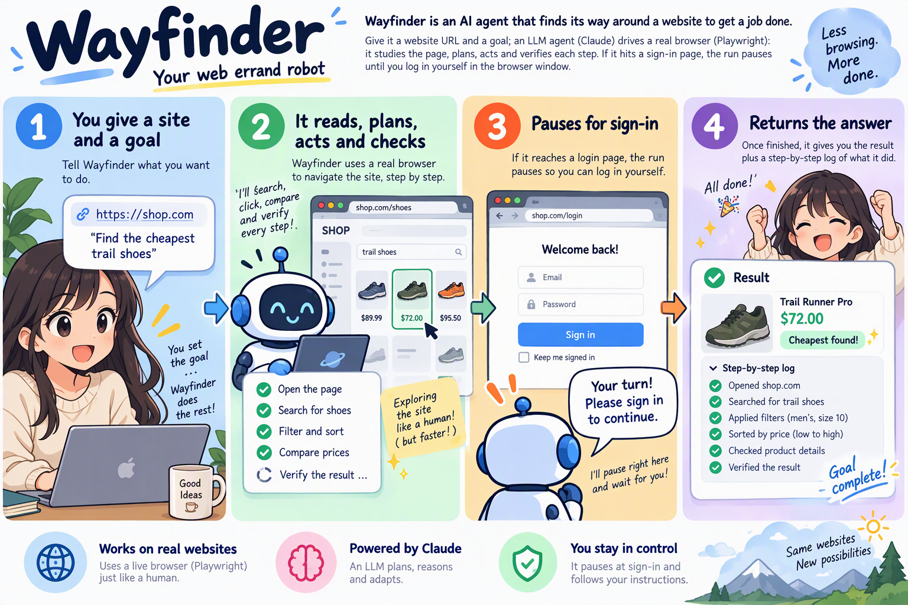

# Wayfinder

**Wayfinder** is an AI agent that finds its way around a website to get a job done. Give it a website URL and a goal;
an LLM agent (Claude) drives a real browser (Playwright): it studies the page, plans, acts and verifies each step.
If it hits a sign-in page, the run **pauses** until you log in yourself in the browser window.



See [FEATURES.md](FEATURES.md) for the full feature map. This is **Phase 1 (MVP)**.

## Quick start

Get the code and run everything from the project folder in **Git Bash**:

```bash
git clone https://github.com/gelob33/wayfinder.git
cd wayfinder
```

### 1. One-time setup

```bash
uv sync                                # install Python dependencies
uv run playwright install chromium     # download the browser Playwright controls
cp .env.example .env                   # create your env file
```

Open `.env` and put your Anthropic API key on the first line (no quotes, no spaces):

```
ANTHROPIC_API_KEY=sk-ant-...
```

`.env` is git-ignored. If you are logged in with `ant auth login`, the key line can stay empty.

### 2. Check the install (no API key or internet needed)

```bash
uv run pytest
```

You should see `9 passed`.

### 3. First run: a safe, read-only task

```bash
uv run python main.py --url https://books.toscrape.com --goal "Find the price of the cheapest book in the Travel category" --success "Return JSON with title and price" --dry-run
```

What happens:

1. A Chrome/Chromium window opens on the site. **Leave it open and visible.**
2. The terminal prints one line per step, e.g. `[3] click id=12 -> Clicked [12] "Travel".`
3. When the agent finishes, the terminal shows `=== RESULT ===` with the status, summary and the JSON result, and the browser closes.

### 4. Your own task

```bash
uv run python main.py --url https://your-site.com \
    --goal "Get a car insurance quote" \
    --success "Return JSON with premium and excess" \
    -i make=Toyota -i model=Corolla -i year=2018 -i postcode=1010 \
    --dry-run
```

(In Git Bash a backslash `\` at the end of a line continues the command. Or put it all on one line.)

- `-i key=value` gives the agent data it may type into forms. It is told not to invent personal data; if something is missing it asks you in the terminal.
- Start with `--dry-run`. It blocks clicks on submit/pay/send-like buttons and any submission of a POST form (button or Enter); plain GET forms such as site search still work. Without it you are asked `Allow? [y/N]` before each such action. These checks are heuristics, not a guarantee: watch the first run on any new site.

## When the run pauses (you are needed)

| Terminal shows | What to do |
|---|---|
| `PAUSED: sign-in needed` | Log in **in the browser window** yourself (including MFA/CAPTCHA), then press **Enter** in the terminal. Type `abort` to stop. The sign-in is saved in `data/browser-profile/`, so you won't need to repeat it next time. See [Websites that require sign-in](#websites-that-require-sign-in). |
| `PAUSED: the site is showing a bot-verification (CAPTCHA) page` | Complete it in the window if it lets you, then press Enter. If the site keeps rejecting the agent's browser the run ends as `blocked`; try [Mode B](#mode-b-hand-over-your-own-browser-sign-in-yourself-then-let-the-agent-work). |
| `The agent needs your input` | Type your answer and press Enter. Don't type passwords or card numbers. |
| `APPROVAL NEEDED` | The agent wants to click a submit/pay/send-like button or submit a POST form. Type `y` to allow, anything else to decline. |
| `SIGN-IN ON ANOTHER SITE` | The agent was sent to a login page on a different host. Type `y` only if you recognise the host as your real sign-in provider (e.g. `accounts.google.com`); a look-alike may be phishing. Declining sends the agent back. |

Press **Ctrl+C** at any time to stop; the partial log is still saved.

## Websites that require sign-in

Credentials never go to the AI model: you always sign in yourself, in a real browser window. There are two ways
to do it. Pick the one that fits the site.

| | **Mode A: default (agent launches the browser)** | **Mode B: hand over your own Chrome** (`--cdp-url`) |
|---|---|---|
| Use it when | Normal username/password or Google/SSO login, no bot checks | The site shows a bot check ("Verify you are human" / Cloudflare), keeps looping on CAPTCHA, or blocks the agent's browser; also for stubborn MFA/SSO flows |
| Sign-in happens | When the agent reaches a login page, it **pauses**; you sign in in the window it opened and press Enter | **Before** you start the agent, in a Chrome you launched yourself |
| Session is kept in | `data/browser-profile/` (reused on the next run) | `C:/Users/xxxxxx/chrome-agent-profile` (your own Chrome profile) |
| Extra steps | None | Launch Chrome with a debugging port first |

**Rule of thumb:** start with Mode A. If the run ends with status `blocked`, or you keep seeing a verification page
that never lets you through, use Mode B.

### Mode A: sign in when the agent pauses

```bash
uv run python main.py --url "https://www.example.com/" --goal "..." --dry-run
```

1. Keep the browser window the agent opens visible.
2. When the terminal prints `PAUSED: sign-in needed`, sign in **in that window** (including MFA/CAPTCHA).
3. Press **Enter** in the terminal. The agent continues from the signed-in page.
4. Next time you run against the same site you are usually still signed in.

### Mode B: hand over your own browser (sign in yourself, then let the agent work)

You launch Chrome yourself, sign in as a normal person, then attach the agent to that already-signed-in browser.
There are three steps. Steps 1 and 2 only prepare the browser; **step 3 is the only command that starts the agent.**

```
Step 1  Launch Chrome (no debug port) -> sign in -> close it     once per site (repeat if the sign-in expires)
Step 2  Launch the same Chrome profile WITH the debug port       each time you start working
Step 3  Run the agent with --cdp-url                             each task (repeat for more tasks)
```

Run these in Git Bash. Close other Chrome windows first.

**Step 1: sign in (normal Chrome, no debugging port)**

```bash
"/c/Program Files/Google/Chrome/Application/chrome.exe" --user-data-dir="C:/Users/xxxxxx/chrome-agent-profile" &
```

In that window open the site, complete any verification, and sign in (Google, email/password, MFA, ...). Then
**close the window completely** so the profile saves the session. Signing in here, before the debugging port is
on, avoids sign-in buttons (such as "Continue with Google") that can misbehave in a browser started with a debug port.

**Step 2: relaunch the same profile with the debugging port**

```bash
"/c/Program Files/Google/Chrome/Application/chrome.exe" --remote-debugging-port=9222 --user-data-dir="C:/Users/xxxxxx/chrome-agent-profile" &
```

You should still be signed in. Leave this window open and **keep DevTools closed** (see Troubleshooting).
To confirm the port is up, open <http://localhost:9222/json/version> in another browser.

**Step 3: run the agent**

```bash
uv run python main.py --cdp-url http://localhost:9222 --url "https://www.example-store.com/account/orders" --goal "List my five most recent orders with date, item names and total" --success "Return JSON list of orders with order_date, items and total" --dry-run
```

- `--url` is the page to start from; `--goal` is the task in plain English; keep `--dry-run` on while testing.
- The agent attaches to your open tab and navigates to `--url`. If it still asks you to sign in, do it in that
  window and press Enter.
- When the run ends the agent only disconnects: Chrome and your sign-in stay open, so you can run step 3 again for
  another task. Close the window when you are finished.

**When to use which command**

| You want to... | Run |
|---|---|
| Sign in to a site for the first time (or the session expired) | Step 1, then close the window |
| Start working with a signed-in site | Step 2, then step 3 |
| Do another task right away | Just step 3 again (Chrome from step 2 is still open) |
| Use a site with no login or bot checks | Skip all of this: `uv run python main.py --url "..." --goal "..." --dry-run` (Mode A) |

Tips:
- The sign-in lives in `chrome-agent-profile`, so on later days you usually only need steps 2 and 3.
- `--cdp-url` ignores `--headless`, `--channel` and `--profile`: it uses the Chrome you started.

Notes:
- The debugging port gives full control of that browser, so use the dedicated profile, don't browse other sites in
  it, and close it when done.
- The agent adds no stealth or fingerprint masking, so a site may still challenge or block automated activity (and
  its terms of use may restrict automation or risk account restrictions). If that happens the run stops with status
  `blocked`; the agent never tries to bypass bot protection. Consider doing the task manually or using the site's
  official API or data export instead.
- Use `--dry-run` while you check the flow; remove it only when you want the agent to be able to submit things
  (you are still asked to approve each submit/pay/send-like click).

## Options

| Flag | Meaning |
|---|---|
| `--url`, `--goal` | Required: start page and what to achieve |
| `--success` | Describes the output you want (shapes the JSON result) |
| `-i key=value` | Input data for forms (repeatable) |
| `--dry-run` | Block submit/pay/send/delete-like clicks and POST form submissions |
| `--no-approval` | Don't ask before such actions (use with care) |
| `--allow-code` | Let the agent write and run Playwright code (`run_playwright`) for hover menus, drag and bulk reading. **Off by default; only for sites you trust** (see Security) |
| `--max-steps` (40), `--max-seconds` (900) | Budgets |
| `--headless` | Hide the browser (don't use if a sign-in may be needed) |
| `--channel chrome` | Use your installed Chrome (or `msedge`) instead of bundled Chromium |
| `--allow-domain` | Allow an extra domain, e.g. a separate login or payment domain (repeatable) |
| `--profile` | Browser profile folder (default `data/browser-profile`) |
| `--cdp-url` | Attach to a Chrome you launched with `--remote-debugging-port` (see above) |
| `--model` | Model id (default `claude-sonnet-5-5`, or set `WAYFINDER_MODEL`) |

## Output

Each run creates `runs/<YYYYMMDD-HHMMSS>/`:

| File | Contents |
|---|---|
| `result.json` | status (`success`, `incomplete` = agent claimed done with unverified checklist items, `failed`, `aborted`, `budget_exceeded`, `error`), the checklist, summary, your requested output in `result`, step and token counts |
| `steps.jsonl` | one line per action: args (incl. plans and generated code), outcome, URL, detected changes, login-pause events |
| `step-000.txt`, `step-001.txt`, ... | what the agent saw after each step (for auditing its claims) |
| `step-001.png`, ... | screenshot after each step |

The terminal prints `Run folder: ...` at the start and `log: ...` at the end. Exit code is `0` only on success.
`runs/` and `data/` are git-ignored; `data/browser-profile/` holds your session cookies, so keep it private.

## Security

Wayfinder drives a real browser with your sessions and feeds web pages to an AI model, so treat it with care.

- **Web pages are untrusted input.** A page can contain text written to manipulate the model ("prompt injection").
  Wayfinder limits what a manipulated model can do (below), but cannot rule it out. Don't point it at sites you
  don't trust while signed in to accounts that matter.
- **`--allow-code` is off by default, on purpose.** With it, the model writes Python that runs on your machine.
  The guards around that code reduce the risk but are **not a security boundary**; Python cannot be sandboxed
  reliably in-process. Enable it only for sites you trust.
- **Dry-run and approvals are heuristics.** They catch submit/pay/send-like labels and POST form submissions.
  A page that changes something on a plain click or a GET request, or labels its button unusually, is not caught.
- **There is no network allowlist.** The agent only navigates within the target site (plus sign-in hosts you
  approve), but pages themselves can still load and call other domains as usual.
- **What leaves your machine:** the page text, element labels, URLs and non-sensitive field values of every page the
  agent visits are sent to the model provider's API. Password, card and one-time-code fields are never read or
  filled, but other personal data shown on a page is included.
- **Run logs (`runs/`) are sensitive.** They hold page text and screenshots of signed-in pages. Typed text, your
  answers to the agent's questions and URL query strings are redacted, but the pages' own content is not.
  `runs/` and `data/` are git-ignored; delete runs you no longer need.
- **Attach mode (`--cdp-url`)** gives the agent the whole Chrome profile you launched. Use the dedicated profile
  only, and close it when done.

## Troubleshooting

| Problem | Fix |
|---|---|
| `Could not resolve authentication method` / 401 | `ANTHROPIC_API_KEY` is missing or wrong in `.env` (run from the project folder so `.env` is found) |
| `Executable doesn't exist ... playwright install` | Run `uv run playwright install chromium` |
| Agent says a page was "blocked (outside the allowed site)" | The site redirected to another domain; add it with `--allow-domain` |
| Page is greyed out / "Debugger paused in another tab" (Mode B) | Chrome DevTools is open on that tab and the site hit a `debugger` statement. Click the yellow tooltip to switch to the tab, press **F8** to resume, and close DevTools (or Sources > Deactivate breakpoints, Ctrl+F8) |
| "Continue with Google" / sign-in buttons do nothing (Mode B) | Resume a paused page first (above); allow popups for the site; sign in during Step 1 (no debug port) instead of Step 2 |
| Agent loops or gives up | Make the goal more specific, supply `-i` inputs, raise `--max-steps`, and check the screenshots in the run folder |
| Site shows a CAPTCHA / bot wall (Cloudflare "Verify you are human") | The run pauses once so you can complete it. If the site keeps rejecting the automated browser, the run ends with status `blocked`. The agent does not try to bypass bot protection; do the task manually or use an official API/export if the site has one |
| Wayfinder will not act on a login page | By design: it pauses for you; credentials never go to the LLM |

## What Phase 1 includes

| Area | Implemented |
|---|---|
| Intake | CLI: url, goal, inputs, success criteria, step/time/token budgets |
| Browser | Persistent headed Playwright profile, popup/tab following, dialog handling |
| Perception | Page distilled to numbered interactive elements + main text (`wayfinder/perception/snapshot.py`) |
| Agent | Explicit graph: observe -> decide -> plan / act -> observe -> verify -> done. Tools: `plan, click, type, select, press, scroll, goto, back, wait, run_playwright, ask_human, done` |
| Plan / Verify | First action must be `plan` (page controls -> goal mapping + checklist). After every action, code reports what changed (checked states, URL, result count) and warns if nothing changed. `done` is rejected until the checklist is complete |
| Generated code (opt-in) | `--allow-code` enables `run_playwright`: the agent writes short Playwright snippets against a guarded `page` (no in-page JavaScript, no raw page/context, password fields refused, risky clicks and POST submits gated, `goto` only to seen links). Defence in depth, not a sandbox |
| HILT | Login/password page detected -> pause until you press Enter; `ask_human`; approval before risky clicks |
| Safety | Domain allowlist, approval for off-site sign-in hosts, sensitive fields never filled, POST submissions and risky clicks gated, page text sanitised and treated as data, dry-run, redacted logs |
| Reporting | JSONL step log, screenshots, result JSON |

## Layout

```
main.py                     entry point
wayfinder/
  cli.py  config.py
  browser/session.py        Playwright session
  perception/snapshot.py    DOM -> numbered elements
  agent/loop.py             graph runner (observe -> decide -> plan/act/verify/done)
  agent/nodes.py            the graph nodes;  state.py = shared RunState
  agent/actions.py          act: executes one browser action with guards
  agent/codeexec.py         guarded execution of model-written Playwright code (--allow-code)
  safety/sanitize.py        strip control chars / fake tags, redact logs
  safety/pagechecks.py      in-page checks: sensitive fields, POST forms, submit controls
  agent/{tools,prompts,llm}.py
  perception/diff.py        verify: what changed between observations
  hilt/human.py             pause / ask / approve
  safety/policy.py          allowlist, sign-in + risky-action detection
  reporting/runlog.py
tests/                      mock site + scripted-LLM tests (no API key needed)
```
